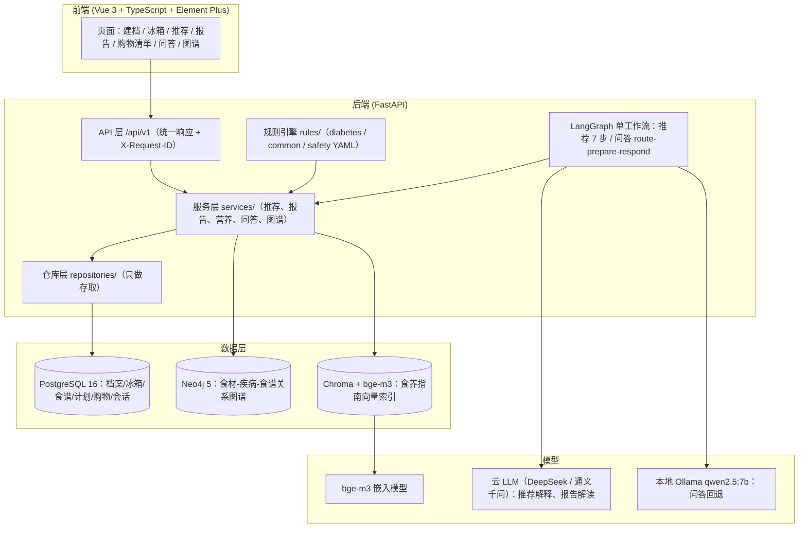

# 糖安食助 · 系统架构

## 架构图

## 分层与职责

| 层 | 目录 | 职责 | 约束 |
|---|---|---|---|
| 前端 | frontend/src | 页面与交互，流式问答用 fetch 读 NDJSON | 接口请求只写在 src/api/ |
| API | backend/app/api/v1 | 参数校验、鉴权、统一响应 | 路由里不写业务逻辑 |
| 服务 | backend/app/services | 业务编排、营养计算、规则调用 | api → services → repositories |
| 仓库 | backend/app/repositories | 纯数据存取 | 查询必须带当前用户 id |
| 规则 | backend/app/rules | 过敏原排除、忌口减分、GI 过滤、安全拦截 | 阈值标「待核对」 |
| 编排 | backend/app/agent | LangGraph 单工作流 | 不引入多 Agent |

## 两个设计说明（答辩必答）

### 为什么是单工作流，而不是多 Agent？

1. **规则不可被绕过**：多 Agent 中「模型决定调用哪个工具」会让模型成为规则的解释者，存在绕过风险。本项目推荐流程固定七步（规则过滤 → 图谱打分 → 检索 → 模板/LLM 解释 → 事后校验），分类器只能调用已写好的服务，不能临时生成新动作。
2. **营养数字可信**：多 Agent 容易让模型编造数值。本项目营养数字全部由后端计算并写入响应，LLM 只把已算好的数字组织成自然语言，post_validate 核对响应数值是否都在后端允许集合内。
3. **可测性**：单工作流每步都是纯函数或可注入依赖（RecommendDeps），单元测试可逐段 mock；多 Agent 调度路径难以穷举。

### 关键词拦截的局限

- safety.yaml 在调用 LLM 前用关键词拦截「用药剂量、诊断、急症（胸痛、低血糖）、肾病、妊娠、未成年」，命中后固定回复就医提示。
- **局限**：换一种说法（如「胸口不太舒服」「肾有点问题」）可能漏过关键词。
- **兜底**：营养数字始终由后端计算，模型不输出治疗或用药建议；回答末尾固定附免责声明；血糖/糖化血红蛋白只记录、不参与推荐。

## 风险与降级

| 场景 | 降级策略 |
|---|---|
| 云 LLM 欠费/不可用 | 推荐改用模板解释；问答回退本地 qwen2.5:7b，仍失败则提示稍后重试 |
| Neo4j / Chroma 不通 | 健康检查标 down；推荐降级为规则 + 库存 |
| 检索命中不足 | 回答仍给出，标注 rag=down 与引用缺失 |
| 模型编造数值 | post_validate 只允许后端允许集合内的数字 |
